# Análisis integrado de resultados del pronóstico

**Alcance.** Este es el análisis diagnóstico integrado que exige el contrato §8.8 (D9.1) sobre la receta vigente: regresión logística sin clima, un modelo por municipio, horizonte de 8 semanas y τ = 0,05 (receta `de74d4ab…fda5`). Describe dónde aporta el modelo frente a B2 (estado del canal), B1 (estacionalidad) y la alerta del canal, dónde no aporta, qué patrones observables acompañan cada caso y cómo influyen las propiedades de las métricas en la lectura. El análisis da el mismo peso a las dos capas del sistema (§2.4, §7.1): la **estimación**, es decir, la calidad de la probabilidad semanal de estar en zona epidémica a 8 semanas, que es lo que el modelo predice, y la **decisión**, es decir, las alertas y su capacidad de avisar inicios de brote.

**No modifica ninguna conclusión de §8.4**, no recalcula los resultados de la prueba ni reentrena modelos. La prueba 2023–2025 se ejecutó una sola vez (`reports/forecasting/bitacora_prueba.jsonl`, ejecución 1, código `abf08c2`) y los reportes derivables son los de U7.5 (`reportes_20261112/manifiesto_reportes.json`, código `300cb08`).

**Cómo leer este documento.**

- **Marcas.** [H] hecho tomado de la evidencia congelada; [I] inferencia; [R] recomendación; [D] decisión; [P] pendiente (glosario de `docs/forecasting/README.md`, apartado 7). Se añade **[X], exploratorio**: un cálculo que no se declaró antes de abrir la prueba. Incluye los estratos que usan información posterior a la emisión (fase respecto a un episodio, semanas desde su fin, estado de una alerta en un inicio) y las métricas descriptivas que el contrato no fija (umbrales distintos de τ, AUC, estratos por zona del canal). Una cifra [X] describe; no es una conclusión ni una prueba estadística (§8.5).
- **Referencias.** «§» remite al contrato predictivo (`docs/forecasting/contrato_predictivo.md`). Las referencias internas se escriben «sección N» o «apartado N.M».
- **Rótulos.** Desarrollo 2019–2022 se rotula «usado para elegir»: esos datos sirvieron para elegir la familia, el conjunto de variables, los hiperparámetros y τ, así que no estiman el desempeño. El desempeño se lee en prueba 2023–2025.
- **Fuentes.** Salvo que se indique otra raíz, las rutas de evidencia son relativas a `reports/forecasting/evidence/` y las de figuras a `reports/forecasting/figures/`. Las cifras [X] y sus figuras las produce `docs/forecasting/verificacion/analisis_integrado_exploratorio.py`, que escribe en `exploratorio_20261112/` (tablas) y en `figures/exploratorio_20261112/` (figuras). El script recalcula además, de forma independiente, las 480 cantidades de U7.5 que cita este documento (casillas, habilidad, clasificación en τ, Murphy, calibración anual, eventos y semanas bajo alerta), y todas coinciden con las tablas congeladas (`exploratorio_20261112/contraste_u75.csv`).
- **Vocabulario (§9.5).** «Semana en zona epidémica» para y = 1; «brote» solo en «inicio de brote» (§2.4). Un *episodio* es una racha de ≥ 3 semanas en zona epidémica (§8.8). La *persistencia* es la regla que predice que el municipio estará en zona epidémica en t + 8 si lo está en t.

---

## 1. Resumen

**Tabla 1.** Conclusiones de §8.4 en prueba [H]. Fuente: `prueba_20261112/resumen_prueba.json`.

| Comparación | Nivel (§8.4) | Métrica global | Casillas ganadas (Brier; log-loss) |
|---|---|---|---|
| Modelo frente a B2 (principal) | **Tendencia favorable** | BSS +0,081; mejora de log-loss +6,3 % | 12 de 18; 12 de 18 |
| Modelo frente a B1 | **Mejora consistente** | BSS +0,468; mejora de log-loss +43,5 % | 15 de 18; 15 de 18 |
| Ablación del clima (receta sin clima frente a la misma familia con clima) | **Sin mejora** | Brier 0,1413 (receta) frente a 0,1434 (con clima) | 9 de 18; 10 de 18 |
| Eventos frente al canal | **Sin mejora** | Detección 4 de 10 frente a 8 de 10; McNemar con 6 inicios discrepantes, 1 a favor del modelo | — |

La lectura integrada de la evidencia es esta [I]: **el modelo estima mejor que el estado del canal la probabilidad de que un municipio esté en zona epidémica dentro de 8 semanas. Su valor no está en anticipar inicios de brote, para lo cual la alerta del canal sigue siendo mejor, sino en graduar el estado actual del canal: distingue qué epidemias en curso continuarán, qué semanas de alerta del canal tienen más probabilidad de terminar en zona epidémica y qué períodos tranquilos lo seguirán siendo, con probabilidades mejor calibradas que B2.**

Cinco hechos sostienen esa lectura:

1. **Calidad de la probabilidad.** En prueba, el modelo mejora a B2 en las reglas de puntuación propias (BSS +0,081; log-loss +6,3 %) y lo hace sobre todo por calibración: confiabilidad 0,006 frente a 0,015, con la misma resolución. Además ordena mejor las semanas: AP 0,77 frente a 0,61 de B2 y 0,62 de la persistencia; AUC 0,87 frente a 0,79 y 0,80 [X] (sección 3).
2. **Más allá de la zona actual del canal [X].** Dentro de cada zona del canal, B2 asigna prácticamente la misma probabilidad a todas las semanas y el modelo las separa (apartado 3.4):
   - *Zona de alerta del canal:* el 42 % de esas semanas recibe p̂ < 0,05 y solo el 7 % llega a zona epidémica, frente al 32 % de las que reciben p̂ ≥ 0,20.
   - *Zona epidémica:* el 62 % de las semanas recibe p̂ ≥ 0,70 y el 81 % de ellas sigue en zona epidémica 8 semanas después; con p̂ < 0,30 solo sigue el 35 %.
   - *Consistencia:* las cifras de desarrollo son del mismo orden.
3. **La etiqueta binaria no es su fuerte [X].** Si p̂ se convierte en sí o no con el umbral que maximiza F1 en desarrollo (0,30), el modelo iguala a la persistencia en prueba (F1 0,73 y 0,73; MCC 0,58 y 0,59). Lo que gana en las transiciones (recupera el 23 % de las entradas a la zona epidémica y anticipa el 16 % de las salidas, que la persistencia no puede anticipar) lo pierde en semanas persistentes. El valor está en la probabilidad graduada, no en la etiqueta dura (apartado 3.3).
4. **Dónde está la mejora [X].** En prueba, la fase «durante el episodio» aporta el 109 % de la mejora neta del Brier frente a B2 y las semanas tranquilas el 34 %. Las 1–8 semanas previas a un episodio aportan el 7 % y las 1–13 semanas posteriores restan el 49 % (apartado 3.5).
5. **Decisión.** El modelo no anticipa inicios mejor que el canal (4 de 10 frente a 8 de 10). Emite menos alertas, pero más largas y con una proporción de falsas alarmas similar: 82 % frente a 77 % (sección 5).

Con la misma visibilidad:

- El modelo **sobrestima la probabilidad en las semanas que siguen al fin de un episodio**: en las 13 semanas posteriores, p̂ medio 0,51 frente a 6,5 % observado.
- Con un **p̂ bajo en zona de alerta subestima**: 2 % predicho frente a 7 % observado.
- **Barranquilla** es desfavorable en prueba.
- **2025** fue un año adverso en cuatro de seis municipios.
- El bloque climático no aporta capacidad medible.

Destacan Neiva y Villavicencio, favorables en ambos períodos, y Cali, favorable en prueba (sección 2). La sección 4 traduce estos resultados a su valor práctico.

---

## 2. Perfil por municipio

Cada municipio tiene su propio modelo, entrenado solo con sus datos, como pidió el experto de dominio. Lo que comparten es la configuración: C y τ se eligieron con los seis municipios juntos (§6.2, §7.5); los coeficientes son propios. Por eso el análisis empieza por los municipios. La conclusión de §8.4 (12 de 18 frente a B2, 15 de 18 frente a B1) cuenta casillas evaluadas, cada una por el modelo de su municipio; no promedia modelos.

El nivel por municipio de §8.8 (favorable, mixto o desfavorable) es **descriptivo**: con 3 casillas, un modelo equivalente a B2 gana al menos 2 de 3 años la mitad de las veces. Se acompaña de las casillas de desarrollo como contexto de consistencia, no como confirmación.

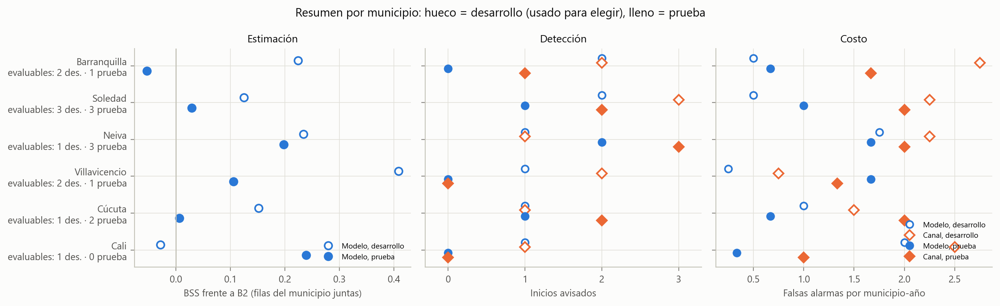

*Figura 1.* Resumen por municipio (marcador hueco: desarrollo, usado para elegir; lleno: prueba). Fuente: `figures/20261112/resumen_municipios.png`.

**Tabla 2.1.** Nivel descriptivo y cifras por municipio en prueba; entre paréntesis, desarrollo (usado para elegir). Fuentes: `prueba_20261112/ficha_desempeno.json`, `prueba_20261112/diag_casillas.csv`, `diagnostico_desarrollo_sin_clima_20261112/diag_casillas.csv` y `reportes_20261112/eventos_razon.csv` [H].

| Municipio | Nivel frente a B2 | BSS frente a B2 | Casillas ganadas a B2 (Brier) | Nivel frente a B1 | AP modelo / B2 | Inicios avisados, modelo / canal | Entradas avisadas, modelo / canal | Falsas alarmas, modelo / canal |
|---|---|---|---|---|---|---|---|---|
| Neiva | Favorable | +0,197 (+0,234) | 3/3 (3/4) | Favorable | 0,78 / 0,62 | 2 / 3 de 3 | 3 / 5 de 7 | 5 / 6 |
| Villavicencio | Favorable | +0,106 (+0,408) | 2/3 (3/4) | Favorable | 0,82 / 0,67 | 0 / 0 de 1 | 0 / 1 de 6 | 5 / 4 |
| Cali | Favorable | +0,239 (−0,028) | 3/3 (2/4) | Favorable | 0,95 / 0,81 | sin inicios | 1 / 0 de 3 | 1 / 3 |
| Soledad | Mixto | +0,029 (+0,125) | 2/3 (2/4) | Favorable | 0,69 / 0,48 | 1 / 2 de 3 | 2 / 8 de 10 | 3 / 6 |
| Cúcuta | Mixto | +0,006 (+0,151) | 1/3 (3/4) | Favorable | 0,66 / 0,59 | 1 / 2 de 2 | 5 / 2 de 8 | 2 / 6 |
| Barranquilla | Desfavorable | −0,053 (+0,224) | 1/3 (3/4) | Favorable | 0,59 / 0,60 | 0 / 1 de 1 | 2 / 3 de 7 | 2 / 5 |

**Tabla 2.2.** Mejora relativa de log-loss frente a B2 por estrato, en prueba; entre paréntesis, desarrollo. «Fuera» y «dentro» son los estratos de transición de §7.2, según la zona observada en la emisión t (información disponible al emitir). «Después» son las semanas objetivo situadas entre 1 y 13 semanas tras el fin de un episodio [X]. Fuente: `exploratorio_20261112/estratos_municipio.csv`.

| Municipio | Fuera de zona epidémica en t | Dentro de zona epidémica en t | Después de un episodio (1–13 semanas) [X] |
|---|---|---|---|
| Neiva | +31 % (+26 %) | +4 % (+30 %) | −34 % (−9 %) |
| Villavicencio | +13 % (+31 %) | +17 % (+43 %) | −29 % (−49 %) |
| Cali | −31 % (+15 %) | +36 % (−37 %) | −3 % (−123 %) |
| Soledad | −13 % (+13 %) | +10 % (+10 %) | −7 % (−34 %) |
| Cúcuta | +2 % (+16 %) | +6 % (+15 %) | −24 % (−15 %) |
| Barranquilla | +0 % (+13 %) | −13 % (+26 %) | −28 % (−47 %) |

**Episodios disponibles para el entrenamiento.** §8.8 pide relacionar cada perfil con los episodios que su modelo vio (`exploratorio_20261112/episodios_entrenamiento.csv`):

| Municipio | Episodios antes de la primera emisión de prueba (2022-11-07) | Episodios antes de la primera emisión de desarrollo (2018-11-12) |
|---|---|---|
| Villavicencio | 11 | 7 |
| Soledad | 10 | 4 |
| Neiva | 6 | 4 |
| Barranquilla | 6 | 4 |
| Cúcuta | 4 | 1 |
| Cali | 3 | 2 |

Los conteos usan la serie elegible desde 2012. No se ve una relación clara con el nivel: Cali, con menos episodios, tiene el mayor BSS de prueba, y Villavicencio y Soledad, con más, quedan en niveles distintos. El caso extremo es Cúcuta en el primer ensayo de desarrollo, entrenado con un solo episodio de 4 semanas.

### 2.1 Neiva (41001): favorable en ambos períodos

Es el caso más sólido. En prueba gana a B2 en los tres años (BSS +0,197; casillas de 2023 a 2025: +0,29, +0,09 y +0,50). En desarrollo gana en tres de cuatro, con BSS +0,234; el año que pierde es 2020, post-epidémico y sin semanas positivas (BSS −1,25).

- **Dónde aporta.** Es el único municipio con un aporte claro fuera de la zona epidémica: +31 % de log-loss en 101 emisiones, con 14 positivas. Dentro de ella mejora un +4 %.
- **Dónde pierde.** En las semanas posteriores al episodio (−34 %, 22 semanas).
- **Eventos.** Avisa 2 de 3 inicios, frente a 3 de 3 del canal, y 3 de 7 entradas, frente a 5 de 7. Falsas alarmas: 5 frente a 6.

Sus dos avisos vienen de una misma alerta, confirmada el 2023-07-03 y encendida durante 66 semanas desde su confirmación. Esa alerta produce el Δw de +7 semanas del inicio del 2023-08-28 (8 semanas de anticipación frente a 1 del canal). Seguía encendida en el inicio del 2024-06-03, que por eso no cuenta como avisado: se había confirmado 48 semanas antes, fuera de la ventana de 12 semanas (§7.4).

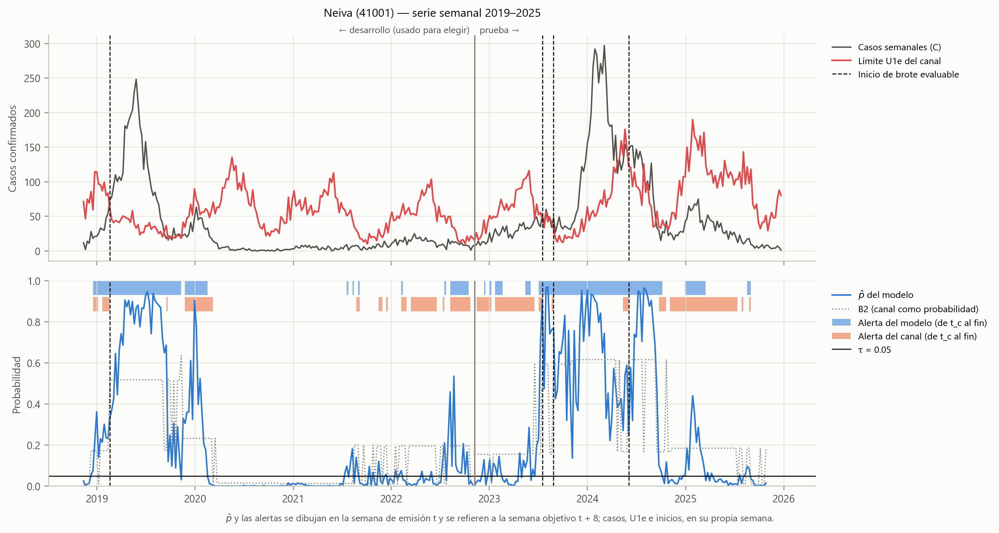

*Figura 2.* Neiva: casos y U1e (arriba), alertas del modelo y del canal (centro), p̂ y B2 (abajo). Fuente: `figures/20261112/serie_41001.png`.

### 2.2 Villavicencio (50001): favorable en ambos períodos

Favorable en prueba (BSS +0,106, gana 2023 y 2024) y el municipio con la mayor mejora en desarrollo (+0,408, tres de cuatro años). En prueba, 2025 es negativo (BSS −0,185): un año epidémico con 9 semanas positivas en el que el modelo pierde frente a B2 y frente a B1. Mejora a B2 fuera y dentro de la zona epidémica (+13 % y +17 %) y pierde después de los episodios (−29 %). En la emisión semanal con τ = 0,05, su MCC es 0,51 frente a 0,06 de B2, que marca como positivas 155 de 156 semanas (`reportes_20261112/clasificacion_tau.csv`); con τ = 0,30 [X], el MCC del modelo (0,61) queda por debajo del de la persistencia (0,65).

Tiene un solo inicio evaluable en prueba (2025-12-01) y no lo avisa ningún sistema: la alerta del modelo se confirmó 13 semanas antes, justo fuera de la ventana de 12 semanas, y se apagó 5 semanas antes del inicio (`exploratorio_20261112/inicios_detalle.csv` [X]). Es el único municipio con más falsas alarmas que el canal (5 frente a 4), y no avisa ninguna de sus 6 entradas, frente a 1 del canal.

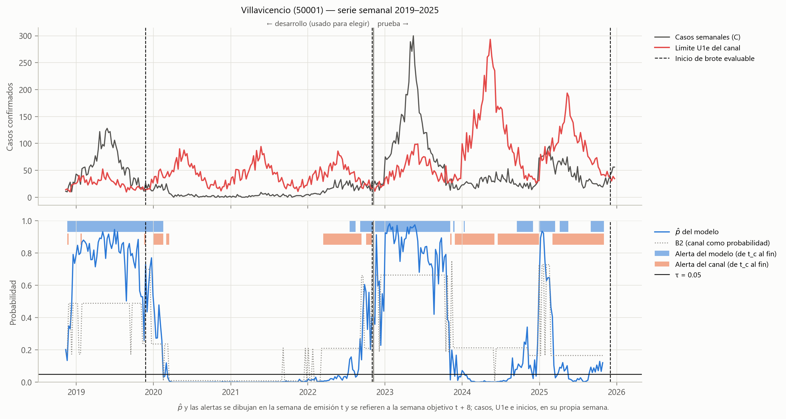

*Figura 3.* Villavicencio. Fuente: `figures/20261112/serie_50001.png`.

### 2.3 Cali (76001): favorable en prueba, inconsistente con desarrollo

En prueba tiene el mayor BSS frente a B2 (+0,239) y la mayor AP (0,95 frente a 0,81), pero en desarrollo el BSS es −0,028 (gana 2019 y 2022, pierde 2020 y 2021), con solo 20 semanas positivas en cuatro años. La mejora de prueba se concentra dentro de la zona epidémica (+36 %), donde están 58 de sus 66 semanas positivas; fuera de ella pierde (−31 %). La casilla de 2025, post-epidémica y sin semanas positivas, aporta un BSS de +0,868 que pesa mucho en cualquier promedio de casillas (apartado 8.1). Por log-loss gana 2 de 3 años: en 2023 el Brier lo favorece (+0,011) y el log-loss no (−18 %). Su ventaja es de calidad de la probabilidad y no de etiqueta: con τ = 0,30 [X], su MCC (0,75) no supera al de la persistencia (0,79). No tiene inicios en prueba, así que en eventos solo se miden falsas alarmas: 1 frente a 3, producto de una sola alerta de 72 semanas.

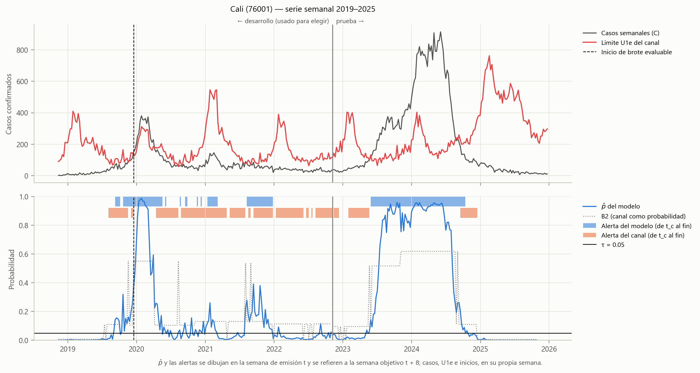

*Figura 4.* Cali. Fuente: `figures/20261112/serie_76001.png`.

### 2.4 Soledad (08758): mixto en ambos períodos

El BSS frente a B2 es positivo pero pequeño (+0,029) y la mejora de log-loss, negativa (−1,6 %); gana 2023 y 2024 y pierde 2025. En desarrollo, BSS +0,125, con dos de cuatro años.

- **Entradas.** El canal es muy superior: avisa 8 de 10 frente a 2 de 10 del modelo (en desarrollo, 18 de 20 frente a 6 de 20). Soledad es el municipio con más rachas cortas de la serie (46 rachas, 21 de una semana; §2.2), un patrón de excursiones breves sobre U1e que la alerta del canal, basada en la semana observada, sigue mejor.
- **Emisión y estratos.** El modelo emite positivo en el 73 % de las semanas (114 de 156). Su ventaja dentro de la zona epidémica (+10 %) se compensa con la pérdida fuera de ella (−13 %).
- **Inicios.** Avisa 1 de 3, frente a 2 de 3 del canal, pero el que avisa (2024-12-23, una semana de anticipación) es la única discrepancia de McNemar a favor del modelo. Los dos que no avisa corresponden a una alerta encendida desde 33 semanas antes (2023-07-03) y a una alerta que se apagó 3 semanas antes del inicio (2025-05-26) [X]. Falsas alarmas: 3 frente a 6.

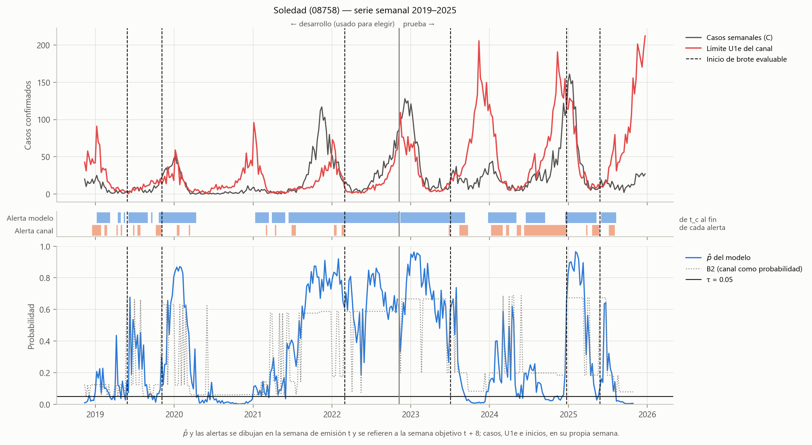

*Figura 5.* Soledad. Fuente: `figures/20261112/serie_08758.png`.

### 2.5 Cúcuta (54001): mixto en prueba, favorable en desarrollo

En prueba el BSS es +0,006 y gana un año por Brier (2024) y dos por log-loss (2023 y 2024). La casilla de 2023, tranquila y con una sola semana positiva, la pierde por Brier (−0,164) y la gana por log-loss (+13 %): un ejemplo de cómo las dos reglas difieren cuando casi no hay positivas. En desarrollo fue favorable (+0,151, tres de cuatro años).

Es el único municipio con más entradas avisadas que el canal (5 de 8 frente a 2 de 8) y tiene un tercio de sus falsas alarmas (2 frente a 6). Avisa el inicio del 2024-01-15 con 7 semanas de anticipación (Δw = +5) y no el del 2025-02-24, porque su alerta estaba confirmada desde 15 semanas antes [X]. Pierde en las semanas posteriores a los episodios (−24 %).

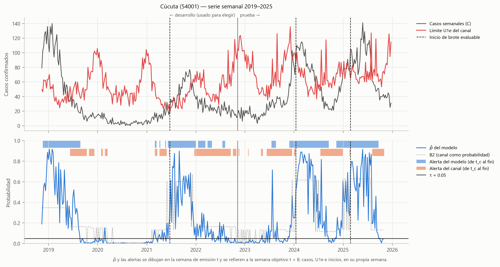

*Figura 6.* Cúcuta. Fuente: `figures/20261112/serie_54001.png`.

### 2.6 Barranquilla (08001): desfavorable en prueba, favorable en desarrollo

Es el único municipio desfavorable en prueba: BSS −0,053, gana solo 2023 (+0,136) y pierde 2024 (−0,156) y 2025 (−0,040). En desarrollo fue favorable (+0,224, tres de cuatro años). Pierde incluso dentro de la zona epidémica (−13 %), el estrato en que los demás municipios ganan, y su AP es prácticamente la de B2 (0,59 frente a 0,60). El modelo emite positivo en el 78 % de las semanas (121 de 156), la proporción más alta de los seis.

Su único inicio de prueba (2023-04-10) lo avisa el canal y no el modelo, cuya alerta estaba en continuidad desde noviembre de 2022, tras un 2022 con 51 de 52 semanas en zona epidémica [X]. Falsas alarmas: 2 frente a 5.

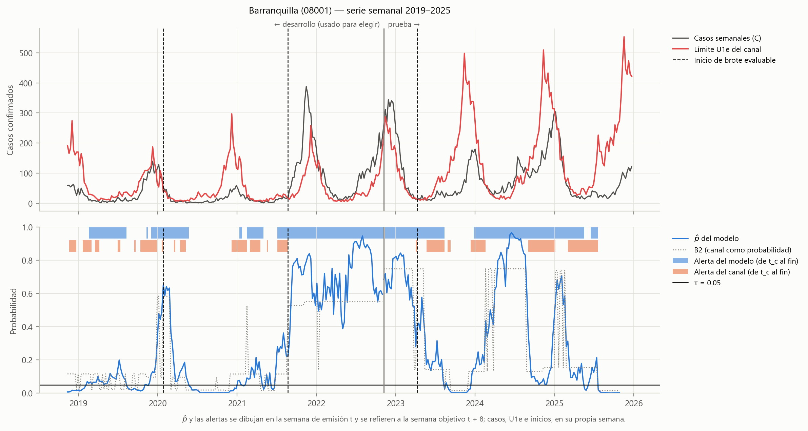

*Figura 7.* Barranquilla. Fuente: `figures/20261112/serie_08001.png`.

### 2.7 Patrones comunes

Contados por municipio, no promediados [H, salvo donde se indica]:

- El modelo supera a B1 en los seis municipios (nivel favorable en todos).
- Su AP supera a la de B2 en cinco municipios; la excepción es Barranquilla.
- En la zona de alerta del canal ordena mejor que B2 las semanas que terminarán en zona epidémica en los seis municipios, y dentro de la zona epidémica, en cinco (AUC por municipio [X]; apartado 3.4).
- Pierde frente a B2 entre 1 y 13 semanas después de un episodio en las 12 combinaciones municipio-período [X].
- En los cinco municipios con inicios en prueba, el canal avisa al menos tantos inicios como el modelo.
- El modelo tiene menos falsas alarmas que el canal en cinco de seis municipios.

Lo propio de cada municipio está en el estrato donde gana: Neiva, fuera de la zona epidémica; Cali, dentro de ella; Villavicencio, en ambos; Cúcuta, en las entradas; Barranquilla, en ninguno.

---

## 3. Calidad de la estimación

Esta sección responde a la pregunta del sistema (§9.2): ¿qué tan bien estima el modelo la probabilidad de que el municipio esté en zona epidémica dentro de 8 semanas? La juzgan las reglas de puntuación propias, la calibración, la discriminación y la clasificación de la etiqueta. Salvo el Brier y el log-loss que usa §8.4, ninguna de estas métricas decide; explican de dónde sale el resultado.

### 3.1 Reglas de puntuación y calibración

**Tabla 3.1.** Puntuación, calibración y nitidez en prueba; entre paréntesis, desarrollo. Fuentes: `reportes_20261112/murphy.csv`, `calibracion_anual.csv` y `prueba_20261112/resumen_prueba.json` [H]; la descomposición de B2 y la nitidez, `exploratorio_20261112/murphy_b2.csv` y `zona_canal.csv` [X].

| Métrica | Modelo | B2 | Lectura |
|---|---|---|---|
| Brier | 0,141 (0,101) | 0,154 (0,124) | Menor es mejor |
| Log-loss | 0,441 | 0,471 | Menor es mejor |
| Confiabilidad (Murphy, 10 intervalos de igual frecuencia) | 0,006 (0,003) | 0,015 (0,012) [X] | Menor es mejor: favorece al modelo |
| Resolución (mismos intervalos) | 0,087 (0,093) | 0,087 (0,074) [X] | Mayor es mejor: empate en prueba; en desarrollo ganaba el modelo |
| Calibración en grande 2023 / 2024 / 2025 | −0,067 / −0,002 / +0,012 | −0,091 / −0,018 / +0,033 | Más cerca de 0 es mejor: el modelo, los tres años |
| Nitidez: desviación estándar de p̂ | 0,35 (0,30) | 0,26 (0,21) [X] | Mayor es más informativa, si está calibrada |

El Brier se descompone en confiabilidad − resolución + incertidumbre, más un residuo por agrupar. En prueba la incertidumbre es la misma para ambos (0,226) y la resolución es prácticamente igual, así que **la ventaja global del modelo sobre B2 en prueba viene de la calibración** [X]: asigna probabilidades más cercanas a las frecuencias observadas. En desarrollo ganaba en ambos términos. El modelo es además más nítido: sus probabilidades se separan más de la prevalencia sin perder calibración global, que es lo que se pide de un pronóstico probabilístico útil. La resolución por intervalos no capta toda la información de orden de las semanas, que se mide con AP y AUC (apartado 3.2) y depende del agrupamiento (apartado 8.7).

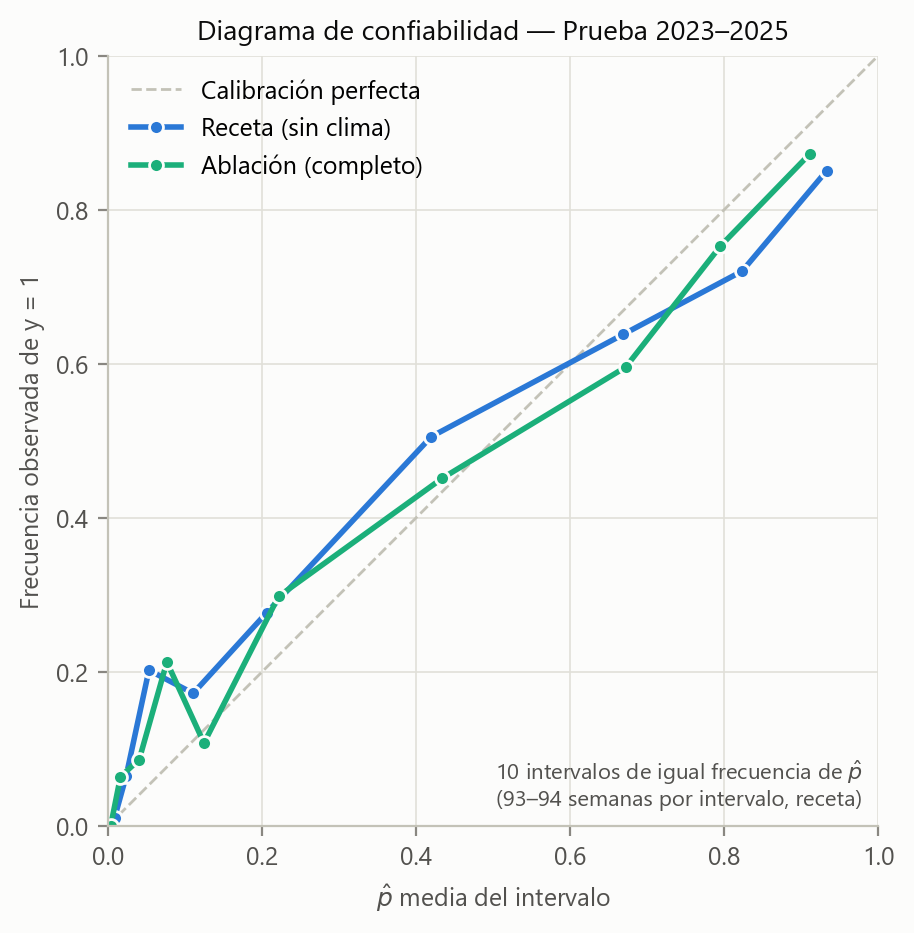

*Figura 8.* Diagrama de confiabilidad de la receta y de la ablación en prueba. Fuente: `figures/20261112/confiabilidad_prueba.png`. La versión de desarrollo está en `figures/20261112/confiabilidad_desarrollo.png`.

La calibración global es buena, pero el modelo es **demasiado extremo en ambas direcciones** [H, `reportes_20261112/confiabilidad.csv`]: en el intervalo con p̂ medio ≈ 0,05 la frecuencia observada es 20 %, y en el de p̂ ≈ 0,93 es 85 %. Las probabilidades bajas no garantizan tranquilidad y las altas sobrestiman algo la persistencia. El apartado 3.4 muestra que la subestimación de los p̂ bajos se concentra en la zona de alerta del canal.

### 3.2 Discriminación sin umbral

La AP y la AUC miden si el modelo ordena las semanas de mayor a menor probabilidad real, sin fijar un umbral ni exigir calibración. La AUC no es una métrica del contrato y se reporta solo como descripción [X].

**Tabla 3.2.** Discriminación de la etiqueta semanal en prueba; entre paréntesis, desarrollo. Fuentes: `prueba_20261112/resumen_prueba.json` y `prueba_20261112/diag_transicion.csv` [H]; desarrollo, persistencia y AUC, `exploratorio_20261112/zona_canal.csv` [X].

| Filas | Prevalencia | AP modelo | AP B2 | AP persistencia | AUC modelo | AUC B2 | AUC persistencia |
|---|---|---|---|---|---|---|---|
| Todas | 0,34 (0,26) | 0,77 (0,76) | 0,61 (0,62) | 0,62 (0,61) | 0,87 (0,92) | 0,79 (0,86) | 0,80 (0,82) |
| Fuera de zona epidémica en t | 0,13 (0,09) | 0,29 (0,36) | 0,14 (0,15) | — | — | — | — |
| Dentro de zona epidémica en t | 0,71 (0,75) | 0,85 (0,85) | 0,66 (0,67) | — | 0,69 (0,69) | 0,36 (0,36) | — |

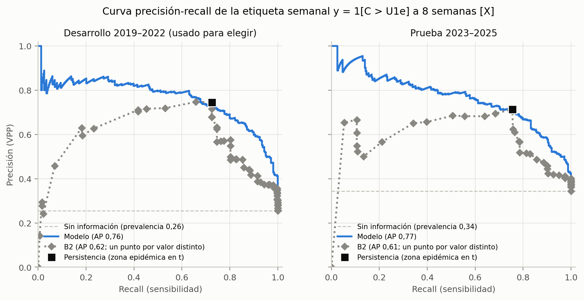

*Figura 9.* Curva precisión-recall del modelo, con B2 (un punto por cada valor distinto) y la persistencia como referencias [X]. Fuente: `figures/exploratorio_20261112/clasificacion_pr.png`.

El modelo domina a B2 en casi toda la curva y pasa por el punto de la persistencia (Figura 9). La ventaja está a la izquierda de ese punto, en la región de alta precisión: el modelo identifica un subconjunto de semanas con certeza mayor que la que da la persistencia (precisión de 0,80 o más hasta un recall de 0,4, y cercana a 0,78 hasta 0,55, frente a 0,72 de la persistencia). También está a la derecha, donde recupera semanas positivas que la persistencia no marca, con precisión que decae más despacio que la de B2. En los dos períodos la AP es casi la misma (0,76 y 0,77), un signo de estabilidad. Dentro de cada estrato de transición, donde la persistencia ya no informa, la AP del modelo duplica la de B2 fuera de la zona epidémica (0,29 frente a 0,14) y la supera dentro (0,85 frente a 0,66).

### 3.3 La etiqueta como clasificación semanal

Para leer la etiqueta como un sí o un no hay que elegir un umbral, y el resultado depende mucho de él. τ = 0,05 se eligió para avisar inicios de brote (§7.5), no para clasificar semanas, y con ese valor B2 marca el 89 % de las semanas. Por eso la tabla compara tres umbrales:

- **0,05:** el de la receta (§7.3, [H]).
- **0,30:** el que maximiza la F1 del modelo en desarrollo, elegido sin mirar la prueba [X].
- **0,50:** sin selección [X].

En todos los casos la referencia más exigente es la persistencia. En prueba, B2 coincide exactamente con ella para cualquier umbral entre 0,25 y 0,60, porque solo la zona epidémica le da una probabilidad alta.

**Tabla 3.3.** Clasificación semanal de la etiqueta en prueba; entre paréntesis, desarrollo. Fuentes: `reportes_20261112/clasificacion_tau.csv` [H, τ = 0,05]; `exploratorio_20261112/clasificacion_umbrales.csv` [X].

| Sistema y umbral | Semanas marcadas | Recall | Especificidad | Precisión (VPP) | VPN | F1 | MCC |
|---|---|---|---|---|---|---|---|
| Modelo, τ = 0,05 (receta) | 65 % (53 %) | 0,96 (0,98) | 0,51 (0,62) | 0,50 (0,47) | 0,96 (0,99) | 0,66 (0,64) | 0,46 (0,53) |
| B2, τ = 0,05 | 89 % (70 %) | 1,00 (0,98) | 0,17 (0,39) | 0,39 (0,36) | 1,00 (0,99) | 0,56 (0,53) | 0,26 (0,36) |
| Modelo, τ = 0,30 (F1 máxima en desarrollo) | 40 % (28 %) | 0,79 (0,78) | 0,81 (0,89) | 0,68 (0,71) | 0,88 (0,92) | 0,73 (0,74) | 0,58 (0,65) |
| Modelo, τ = 0,50 | 32 % (22 %) | 0,68 (0,65) | 0,87 (0,93) | 0,73 (0,77) | 0,84 (0,89) | 0,70 (0,70) | 0,55 (0,62) |
| Persistencia (= B2 con τ = 0,30) | 36 % (25 %) | 0,76 (0,72) | 0,84 (0,92) | 0,72 (0,75) | 0,87 (0,91) | 0,73 (0,73) | 0,59 (0,65) |
| Marcar todas las semanas | 100 % | 1,00 | 0,00 | 0,34 (0,26) | — | 0,51 (0,41) | — |

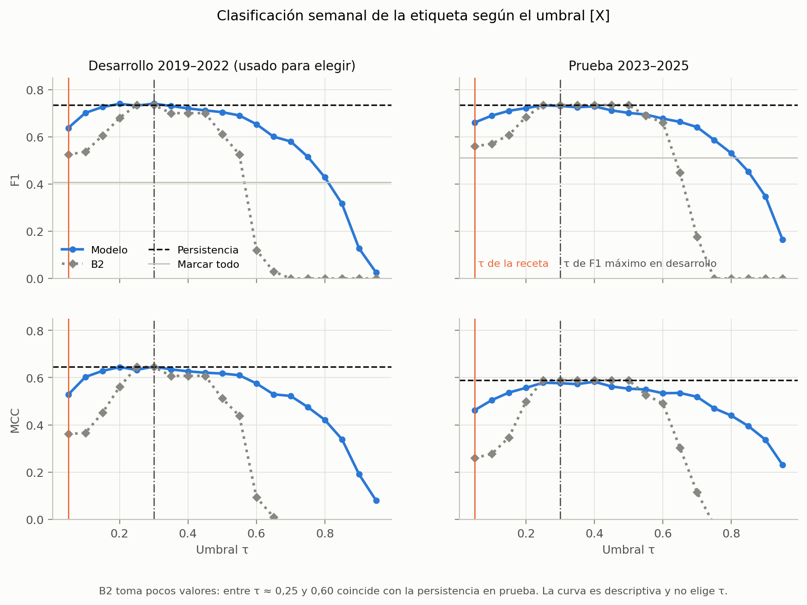

*Figura 10.* F1 y MCC del modelo y de B2 sobre la rejilla de τ, con la persistencia y «marcar todo» como referencias [X]. Fuente: `figures/exploratorio_20261112/clasificacion_umbral.png` y `exploratorio_20261112/clasificacion_curva_tau.csv`.

La lectura tiene tres partes.

- **El MCC de la receta es engañoso como comparación.** Con τ = 0,05 el modelo gana con claridad (MCC 0,46 frente a 0,26), pero frente a una referencia que marca casi todo.
- **Con un umbral razonable, el modelo iguala a la persistencia.** Con el umbral elegido en desarrollo, F1 0,73 frente a 0,73 y MCC 0,58 frente a 0,59 en prueba (en desarrollo, 0,74 frente a 0,73 y 0,65 frente a 0,65). La Figura 10 muestra que la curva del modelo es más ancha que la de B2: mantiene F1 y MCC altos en un rango amplio de τ (de 0,15 a 0,6), mientras que B2 colapsa por encima de 0,6. Pero en ningún umbral supera claramente a la persistencia.
- **El resultado no es parejo por municipio y año.** Con τ = 0,30, el MCC del modelo supera al de la persistencia en Neiva y Soledad, y queda por debajo en los otros cuatro municipios y en 2023 y 2025 (`exploratorio_20261112/clasificacion_umbrales.csv`).

La conclusión [I] es que **la etiqueta dura no muestra el valor del modelo**: al convertir p̂ en sí o no se descarta precisamente lo que el modelo hace mejor (graduar la certeza y calibrarla). Y con una autocorrelación tan alta (el estado cambia en el 12 % de los pares de semanas separadas por 5; §2.2), la persistencia acierta la gran mayoría de las semanas sin información adicional. Dónde el modelo sí añade algo a la etiqueta se ve al separar las transiciones.

**Tabla 3.4.** Clasificación en los estratos de transición con τ = 0,30, en prueba; entre paréntesis, desarrollo [X]. Fuera de la zona epidémica, las positivas son entradas; dentro, las negativas son salidas. Fuente: `exploratorio_20261112/clasificacion_umbrales.csv`.

| Estrato | Semanas (positivas) | Lo que hace el modelo | Persistencia |
|---|---|---|---|
| Fuera de zona epidémica en t | 596 (79) (938 (88)) | Marca el 9 % (8 %) de las semanas; recupera el 23 % (33 %) de las entradas con precisión 0,33 (0,40), frente a una tasa base de 0,13 (0,09) | Recupera el 0 % de las entradas, por construcción |
| Dentro de zona epidémica en t | 340 (243) (310 (231)) | Predice la salida en el 7 % (10 %) de las semanas; acierta en el 65 % (61 %) de esas predicciones, frente a una tasa base de salida de 0,29 (0,25), y anticipa el 16 % (24 %) de las salidas | Anticipa el 0 % de las salidas, por construcción |

Esta es la contribución del modelo a la etiqueta que la persistencia no puede hacer: anticipar parte de las transiciones con una precisión de dos a tres veces la tasa base, de forma consistente en los dos períodos. Es una contribución modesta en volumen (una de cada cuatro o cinco transiciones), y por eso no se nota en las métricas globales: en las semanas sin transición el modelo comete algunos errores que la persistencia no comete.

### 3.4 Lo que la probabilidad añade al estado del canal [X]

La pregunta práctica no es si el modelo supera al canal en general, sino qué le añade a lo que el canal ya dice hoy. La zona del canal en la semana de emisión t es información disponible al emitir, así que este estrato sí corresponde a cómo se usaría el sistema.

**Tabla 3.5.** Desempeño por zona del canal en t, en prueba; entre paréntesis, desarrollo [X]. Fuente: `exploratorio_20261112/zona_canal.csv`.

| Zona en t | Semanas | Frecuencia de zona epidémica en t + 8 | Mejora de log-loss frente a B2 | BSS frente a B2 | AP modelo / B2 | AUC modelo / B2 | Municipios donde el AUC del modelo supera al de B2 |
|---|---|---|---|---|---|---|---|
| Seguridad | 132 (427) | 0,00 (0,03) | +62 % (+27 %) | +0,71 (+0,17) | sin positivas (0,44 / 0,34) | sin positivas (0,96 / 0,91) | — (2 de 2) |
| Alerta | 464 (511) | 0,17 (0,15) | +2 % (+16 %) | +0,02 (+0,11) | 0,29 / 0,14 (0,36 / 0,15) | 0,71 / 0,40 (0,79 / 0,48) | 6 de 6 (5 de 6) |
| Epidemia | 340 (310) | 0,71 (0,75) | +10 % (+19 %) | +0,14 (+0,25) | 0,85 / 0,66 (0,85 / 0,67) | 0,69 / 0,36 (0,69 / 0,36) | 5 de 6 (6 de 6) |

Dentro de una misma zona, B2 solo cambia entre municipios y años; no ordena las semanas. Por eso su AUC por zona queda en torno a 0,4 o por debajo, lo que refleja diferencias entre municipios, no una capacidad de ordenar. El modelo, en cambio, separa las semanas dentro de cada zona, y lo hace en casi todos los municipios y en ambos períodos.

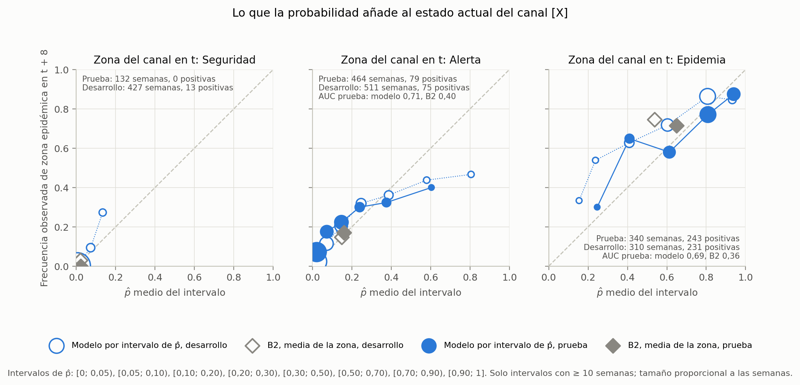

*Figura 11.* Frecuencia observada de zona epidémica en t + 8 según el p̂ del modelo, dentro de cada zona del canal en t; B2, como la media de la zona [X]. Fuente: `figures/exploratorio_20261112/zona_canal.png` y `exploratorio_20261112/zona_canal_intervalos.csv`.

- **Zona de alerta del canal.** Es donde la discriminación aporta más (AUC 0,71 frente a 0,40). La calibración, sin embargo, es débil: con p̂ < 0,05, la frecuencia observada es 7 % y no 2 %; con p̂ entre 0,5 y 0,9, es 33–40 % y no 60–80 %. Por eso la mejora de log-loss en esta zona es solo +2 % en prueba, pese a que el orden de las semanas es bueno. El modelo distingue bien qué semanas de alerta son más y menos riesgosas, pero sus probabilidades en esta zona son demasiado extremas en ambas direcciones.
- **Zona epidémica.** La probabilidad está bien calibrada en los intervalos con muchas semanas y distingue las epidemias que continuarán de las que terminarán. Es la fuente principal de la mejora global (apartado 3.5).
- **Zona de seguridad.** El modelo confirma la tranquilidad con probabilidades casi nulas: en prueba, 128 de las 132 semanas tienen p̂ < 0,05 y ninguna llegó a zona epidémica. B2 asigna en promedio 0,02.

### 3.5 Dónde está la mejora: análisis por fases [X]

Para ver en qué semanas está la mejora, cada semana objetivo se asigna a una fase respecto a los episodios de la serie observada, con este orden de precedencia:

1. **Durante:** dentro de un episodio.
2. **Antes:** un episodio empieza 1–8 semanas después.
3. **Después:** un episodio terminó 1–13 semanas antes.
4. **Resto:** semanas tranquilas.

Las fases usan información posterior a la emisión: son un estrato de diagnóstico.

**Tabla 3.6.** Aporte de cada fase a la mejora neta del Brier frente a B2 y rendimiento en la fase [X]. El aporte de una fase es la suma de (p_B2 − y)² − (p̂ − y)² en sus filas dividida por la suma total; los aportes suman 100 % y pueden ser negativos. Fuente: `exploratorio_20261112/fases.csv`.

| Fase | Semanas objetivo, prueba (desarrollo) | Aporte a la mejora, prueba (desarrollo) | Mejora de log-loss frente a B2, prueba (desarrollo) | BSS frente a B2, prueba | Municipios que ganan por log-loss, prueba (desarrollo) |
|---|---|---|---|---|---|
| Antes (1–8 semanas previas) | 87 (99) | +7 % (−15 %) | +0,7 % (−28 %) | +0,05 | 2 de 6 (1 de 6) |
| Durante el episodio | 291 (289) | +109 % (+128 %) | +11,5 % (+32 %) | +0,17 | 5 de 6 (6 de 6) |
| Después (1–13 semanas) | 132 (103) | −49 % (−19 %) | −25 % (−28 %) | −0,17 | 1 de 6 (1 de 6) |
| Resto (tranquilas) | 426 (757) | +34 % (+6 %) | +32 % (+24 %) | +0,20 | 5 de 6 (6 de 6) |

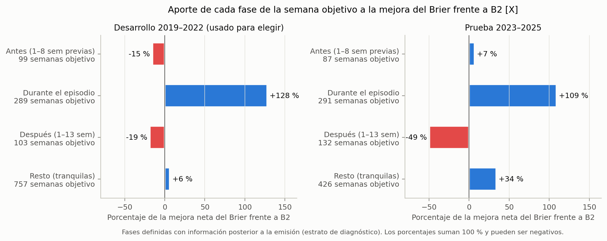

*Figura 12.* Aporte de cada fase a la mejora neta del Brier frente a B2 [X]. Fuente: `figures/exploratorio_20261112/fases_aporte.png`.

La mejora está durante los episodios y en las semanas tranquilas, lo mismo que muestra el análisis por zonas, ahora medido sobre la semana objetivo. En las semanas previas a un episodio el modelo apenas iguala a B2 (prueba) o pierde (desarrollo), y es justo donde estaría la anticipación de un inicio. En las semanas posteriores a un episodio pierde en ambos períodos y en casi todos los municipios. La Figura 13 muestra que el patrón no depende de un solo municipio: «durante» y «resto» son azules en la mayoría de las filas y «después» es rojo en 10 de 12 celdas.

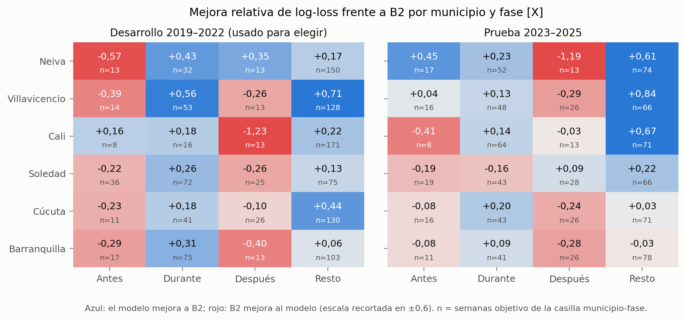

*Figura 13.* Mejora relativa de log-loss frente a B2 por municipio y fase [X]; n = semanas objetivo de la celda. Fuente: `figures/exploratorio_20261112/fases_municipio.png` y `exploratorio_20261112/fases_municipio.csv`.

La pérdida después de los episodios es de calibración. La Figura 14 la mide sin la precedencia de las fases: cuenta las semanas transcurridas desde el fin del último episodio, aunque la semana objetivo esté también en los 8 previos a otro episodio (por eso la ventana de 1–13 semanas tiene 155 semanas objetivo en prueba, y no las 132 de la fase «después»). En esa ventana, en prueba, el p̂ medio del modelo es 0,51 y el de B2 0,48, mientras que la frecuencia observada es 0,065; en desarrollo, 0,47, 0,39 y 0,090. Ambos sobrestiman, el modelo un poco más, y la mejora de log-loss es −21 % (desarrollo, −38 %). En prueba, desde la semana 14 el modelo vuelve a estar más cerca de lo observado que B2; en desarrollo eso ocurre solo desde la semana 27.

Cómo se produce [I]: las semanas objetivo situadas entre 1 y 8 semanas tras el fin de un episodio se emitieron cuando el episodio seguía en curso. El modelo vio un municipio en zona epidémica, con casos altos, y predijo continuidad, pero la epidemia terminó en ese intervalo. Es la contracara de la fortaleza del apartado 3.3: el modelo anticipa algunas salidas (16 % en prueba), pero la mayoría de los finales de episodio lo toman por sorpresa.

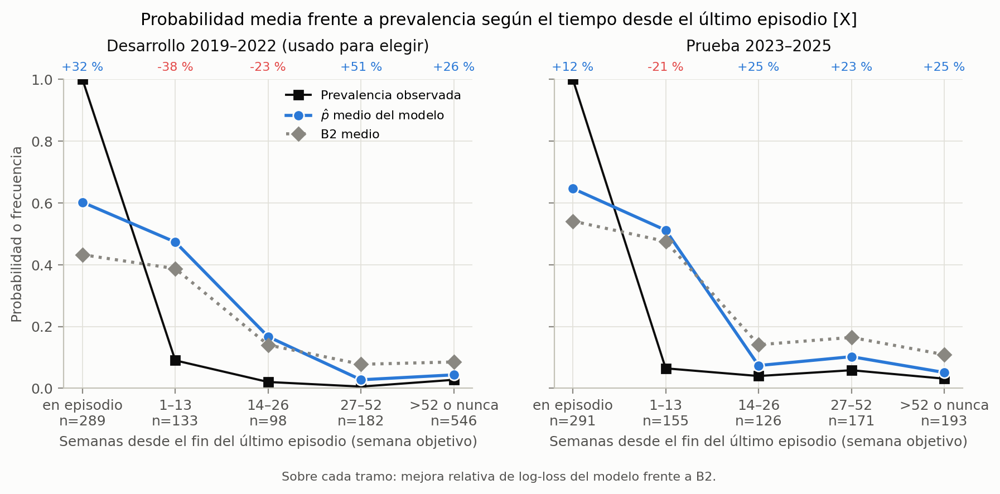

*Figura 14.* p̂ medio, B2 medio y prevalencia observada según las semanas transcurridas desde el fin del último episodio, medidas en la semana objetivo [X]. Fuente: `figures/exploratorio_20261112/semanas_desde_episodio.png` y `exploratorio_20261112/semanas_desde_episodio.csv`.

---

## 4. Valor práctico de la probabilidad

Esta sección traduce los resultados a cómo podría usarse el sistema. Las cifras son [X] y las lecturas, [I] o [R]; ninguna cambia la evaluación de §8.4. El supuesto de partida es la vista principal de §9.3: el usuario ve la zona actual del canal y, junto a ella, la probabilidad p̂ de estar en zona epidémica en t + 8.

**Tabla 4.1.** Guía de lectura: frecuencia observada de zona epidémica en t + 8 según la zona del canal en t y el p̂ del modelo, en prueba; entre paréntesis, desarrollo. Las bandas de p̂ son descriptivas, se fijaron después de ver los intervalos finos y no son umbrales de ninguna regla. Fuente: `exploratorio_20261112/zona_canal_lectura.csv`.

| Zona en t | p̂ del modelo | Semanas de la zona en la banda | Frecuencia observada en t + 8 | Frecuencia de la zona completa | B2 medio en la banda |
|---|---|---|---|---|---|
| Seguridad | < 0,05 | 97 % (86 %) | 0,0 % (0,3 %) | 0,0 % (3,0 %) | 0,02 (0,02) |
| Seguridad | ≥ 0,05 | 3 % (14 %) | 0 de 4 semanas (19,7 %) | | 0,06 (0,04) |
| Alerta | < 0,05 | 42 % (42 %) | 7,1 % (2,3 %) | 17,0 % (14,7 %) | 0,16 (0,15) |
| Alerta | 0,05–0,20 | 38 % (35 %) | 20,1 % (15,6 %) | | 0,16 (0,14) |
| Alerta | ≥ 0,20 | 20 % (23 %) | 31,9 % (36,5 %) | | 0,16 (0,17) |
| Epidemia | < 0,30 | 7 % (10 %) | 34,8 % (38,7 %) | 71,5 % (74,5 %) | 0,61 (0,55) |
| Epidemia | 0,30–0,70 | 31 % (39 %) | 60,4 % (68,6 %) | | 0,67 (0,55) |
| Epidemia | ≥ 0,70 | 62 % (51 %) | 81,0 % (86,1 %) | | 0,65 (0,53) |

La columna de B2 muestra la diferencia: B2 dice prácticamente lo mismo en todas las bandas de una zona, y el modelo separa semanas cuya frecuencia observada difiere entre dos y cinco veces. El patrón se repite en desarrollo y en prueba.

**Usos en los que el modelo genera valor [I].**

1. **Seguimiento de una epidemia en curso (señal de continuidad).** Cuando el municipio ya está en zona epidémica, el canal solo dice eso. El modelo añade cuánto durará. En prueba, el 62 % de esas semanas tuvo p̂ ≥ 0,70 y el 81 % de ellas seguía en zona epidémica 8 semanas después; con p̂ < 0,30, solo el 35 %. Es la fuente principal de la mejora del Brier (+109 % del total, apartado 3.5), se repite en cinco o seis municipios según el período y sirve para planear con dos meses de anticipación la duración de las acciones de control y de la demanda asistencial. Esta señal no es la «alerta de continuidad» de §7.4: con τ = 0,05, el modelo emite positivo en el 99,7 % de las semanas en zona epidémica (`exploratorio_20261112/clasificacion_umbrales.csv`), así que la alerta no informa nada nuevo. Lo que informa es el valor de p̂.
2. **Priorización de las alertas del canal.** La zona de alerta del canal es frecuente (la mitad de las semanas de prueba) y poco específica: solo el 17 % termina en zona epidémica. El modelo la divide en tres grupos: el 42 % de esas semanas, con p̂ < 0,05, tuvo un 7 % de conversión; el 20 %, con p̂ ≥ 0,20, tuvo un 32 %. Ordenar las alertas del canal por p̂ permitiría concentrar la vigilancia donde el riesgo es de dos a cinco veces mayor. Ese orden se cumple en los seis municipios en prueba (AUC del modelo por encima del de B2).
3. **Confirmación de la tranquilidad.** En la zona de seguridad, un p̂ < 0,05 (casi todas las semanas) se acompañó de 0 % de semanas epidémicas en prueba y 0,3 % en desarrollo. Sirve para descartar con confianza que el municipio pase de la seguridad a la zona epidémica en 8 semanas.

**Usos en los que el aporte es modesto [I].**

- **Anticipar transiciones.** El modelo anticipa una de cada cuatro o cinco entradas a la zona epidémica y una de cada seis salidas (Tabla 3.4), con una precisión de dos a tres veces la tasa base. Es información útil, pero no permite confiar en que el modelo avise la mayoría de los cambios de estado.
- **Valores absolutos en la zona de alerta.** El orden es bueno, pero la calibración no: un p̂ de 0,02 en zona de alerta corresponde a un riesgo observado cercano al 7 %, y un p̂ alto, a un 30–40 %. Conviene leer el p̂ en esta zona como un orden relativo más que como una probabilidad literal.
- **Las semanas después del fin de una epidemia.** Durante unas 13 semanas, p̂ sobrestima la probabilidad de seguir en zona epidémica (0,51 predicho frente a 6,5 % observado en prueba).

**Uso en el que no aporta [H].** Avisar inicios de brote: el canal avisa 8 de 10 y el modelo 4 de 10 (sección 5). Con τ = 0,05 la alerta del modelo está encendida el 60 % del tiempo y no es una alarma utilizable para ese fin.

**Implicaciones para la presentación [R].** Estos resultados sugieren que la interfaz de F8 (§9.3) dé el protagonismo a la probabilidad leída junto a la zona del canal, con una guía como la Tabla 4.1 en la ficha de desempeño. El estado de alerta con τ = 0,05 debería mostrarse como información secundaria. Sumaría dos advertencias de uso: tras el pico de una epidemia, p̂ sobrestima la continuidad, y en zona de alerta un p̂ bajo no significa riesgo nulo. Ninguna de estas propuestas cambia la receta ni τ; afectan solo a la comunicación.

---

## 5. Eventos frente al canal

**Tabla 5.1.** Evaluación por eventos (§7.4) en prueba; entre paréntesis, desarrollo (usado para elegir: τ se eligió con esos mismos datos). Fuentes: `reportes_20261112/eventos_razon.csv`, `duracion_alertas.csv` y `prueba_20261112/resumen_prueba.json` [H]; la tasa base, `exploratorio_20261112/tasa_base_alerta.csv` [X].

| Métrica | Modelo | Canal |
|---|---|---|
| Inicios avisados (detección) | 4 de 10 (8 de 10) | 8 de 10 (10 de 10) |
| McNemar sobre inicios discrepantes | 6 discrepantes, 1 a favor del modelo: sin mejora | — |
| Entradas avisadas | 13 de 41 (21 de 44) | 19 de 41 (36 de 44) |
| Alertas juzgables | 22 (38) | 39 (63) |
| Alertas de continuidad (no juzgan inicios) | 4 (5) | 0 (0) |
| Falsas alarmas | 18 (24) | 30 (48) |
| Falsas alarmas por municipio-año | 1,00 (1,00) | 1,67 (2,00) |
| Proporción de alertas juzgables que son falsas | 82 % (63 %) | 77 % (76 %) |
| Anticipación mediana en los inicios avisados | 4,5 semanas (7,5) | 1,5 semanas (3,0) |
| Duración mediana de la alerta, desde t_c (p75; máxima) | 10 semanas (37; 73) | 4 semanas (17; 36) |
| Semanas de emisión bajo alerta | 60 % (47 %) | 42 % (33 %) |
| Inicios con el sistema bajo alerta en la semana del inicio [X] | 8 de 10 (9 de 10) | — |
| Esperados por la tasa base de semanas bajo alerta [X] | 6,0 (4,7) | — |

**Detección.** El modelo avisa 4 de los 10 inicios evaluables y el canal 8. En los 6 inicios en que discrepan, el modelo gana uno (Soledad 2024-12-23) y el canal cinco; con 6 discrepantes, §8.2 exigiría 6 de 6 para una mejora consistente. La curva AMOC de prueba muestra que ningún τ de la rejilla habría pasado de 4 de 10 (`reportes_20261112/curva_amoc.csv`); es descriptiva y no cambia τ (§7.5).

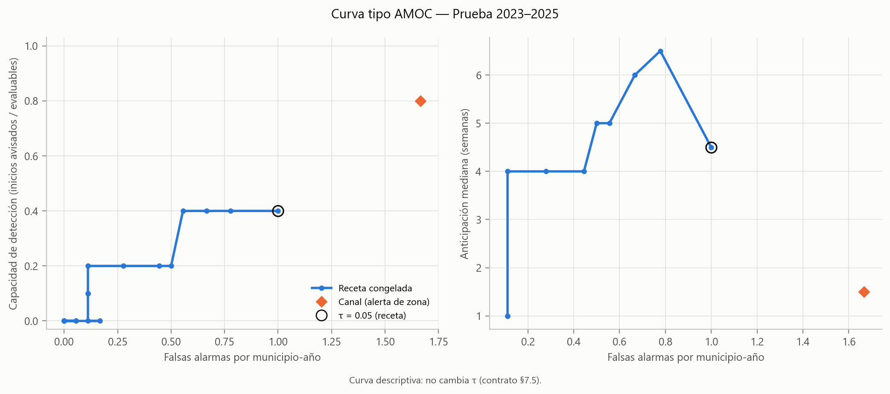

*Figura 15.* Detección y anticipación frente a falsas alarmas por municipio-año sobre la rejilla de τ; el canal es un rombo. Fuente: `figures/20261112/amoc_prueba.png`.

**Falsas alarmas.** El modelo tiene menos falsas alarmas por municipio-año (1,00 frente a 1,67), pero porque emite menos alertas (22 juzgables frente a 39), no porque sean más precisas: el 82 % de sus alertas juzgables es falsa, frente al 77 % del canal. Sus alertas duran más (mediana de 10 semanas desde la confirmación, frente a 4) y pasa bajo alerta el 60 % de las semanas, frente al 42 % del canal. En desarrollo la proporción de falsas sí era menor (63 % frente a 76 %), pero ese período se usó para elegir τ. **La afirmación «menos falsas alarmas cuando avisa» no se sostiene en prueba.**

**Detalle de los avisos y de los fallos** [X]. La Figura 16 muestra las alertas de ambos sistemas alrededor de cada inicio y la Tabla 5.2 resume el estado del modelo.

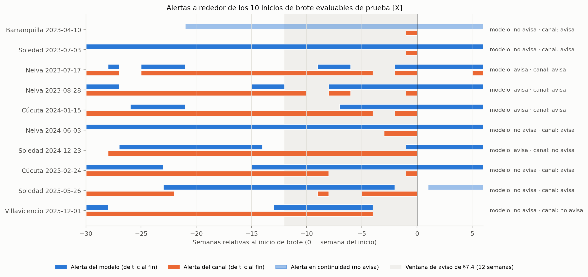

*Figura 16.* Alertas del modelo y del canal entre 30 semanas antes y 6 después de cada inicio evaluable de prueba; la franja gris es la ventana de aviso de §7.4 [X]. Fuente: `figures/exploratorio_20261112/inicios_prueba.png`.

**Tabla 5.2.** Estado de la alerta del modelo en cada inicio evaluable de prueba [X]. Entre paréntesis, la anticipación en semanas (s − t_c). Fuente: `exploratorio_20261112/inicios_detalle.csv`.

| Inicio | Modelo | Canal | Estado de la alerta del modelo |
|---|---|---|---|
| Barranquilla 2023-04-10 | No avisa | Avisa (1) | En continuidad desde 2022-11-14 |
| Soledad 2023-07-03 | No avisa | Avisa (1) | Confirmada 33 semanas antes (2022-11-14), sigue encendida |
| Neiva 2023-07-17 | Avisa (2) | Avisa (2) | Confirmada el 2023-07-03; dura 66 semanas desde t_c |
| Neiva 2023-08-28 | Avisa (8) | Avisa (1) | La misma alerta; Δw = +7 |
| Cúcuta 2024-01-15 | Avisa (7) | Avisa (2) | Confirmada el 2023-11-27; Δw = +5 |
| Neiva 2024-06-03 | No avisa | Avisa (3) | La alerta del 2023-07-03, confirmada 48 semanas antes |
| Soledad 2024-12-23 | Avisa (1) | No avisa | Confirmada el 2024-12-16 |
| Cúcuta 2025-02-24 | No avisa | Avisa (1) | Confirmada 15 semanas antes (2024-11-11), sigue encendida |
| Soledad 2025-05-26 | No avisa | Avisa (5) | Se apagó 3 semanas antes del inicio |
| Villavicencio 2025-12-01 | No avisa | No avisa | Confirmada 13 semanas antes; se apagó 5 semanas antes |

Los cuatro avisos del modelo salen de tres alertas largas, encendidas antes del inicio y que siguieron encendidas después. De los seis fallos:

- En tres, el modelo tenía una alerta encendida en la semana del inicio, pero confirmada más de 12 semanas antes, y §7.4 la cuenta como falsa alarma y no como aviso.
- En Barranquilla la alerta estaba en continuidad.
- En Soledad 2025 la alerta se apagó tres semanas antes.
- El inicio de Villavicencio de diciembre de 2025 no lo avisa ningún sistema.

**Tasa base** [X]. El modelo estaba bajo alerta en la semana de 8 de los 10 inicios. Pero con el 60 % de las semanas de emisión bajo alerta, un sistema que encendiera la alerta en semanas al azar con esa frecuencia estaría bajo alerta en unos 6 de 10, y en prueba la diferencia no permite distinguir esa coincidencia del azar. En desarrollo fueron 9 de 10 frente a 4,7 esperados, pero en ese período se eligió τ. La detección según §7.4 es 4 de 10 y no se redefine.

**Cautela sobre el tamaño.** Diez inicios por período limitan la precisión de la detección (saltos de 10 puntos), no su dirección. Dos indicadores independientes de esa cifra apuntan igual:

- **Las entradas** a la zona epidémica, unas cuatro veces más numerosas: 13 de 41 frente a 19 de 41 (en desarrollo, 21 de 44 frente a 36 de 44).
- **La fase «antes»** del análisis semanal: +0,7 % en prueba y −28 % en desarrollo (apartado 3.5).

---

## 6. Relato por año

Los años se describen con la serie observada (régimen, episodios, inicios) y con el desempeño de cada sistema. El régimen se clasifica con información posterior a la emisión (§8.8).

**Tabla 6.1.** Resumen por año. Régimen: E epidémica, P post-epidémica, T tranquila. Fuentes: `diagnostico_desarrollo_sin_clima_20261112/diag_resumenes.csv`, `prueba_20261112/diag_resumenes.csv`, `reportes_20261112/calibracion_anual.csv` y `diag_eventos.csv` de cada período [H]; MCC con τ = 0,30, `exploratorio_20261112/clasificacion_umbrales.csv` [X].

| Año | Régimen de las 6 casillas | Semanas positivas | BSS frente a B2 | Casillas ganadas a B2 / a B1 | Calibración en grande, modelo / B2 | MCC con τ = 0,30, modelo / persistencia [X] | Inicios avisados, modelo / canal |
|---|---|---|---|---|---|---|---|
| 2019 | 5 E, 1 T | 119 | +0,317 | 5 / 5 | −0,064 / −0,152 | 0,64 / 0,62 | 4 / 5 de 5 |
| 2020 | 2 E, 4 P | 24 | −0,241 | 1 / 2 | +0,080 / +0,062 | 0,24 / 0,32 | 1 / 1 de 1 |
| 2021 | 3 E, 1 P, 2 T | 72 | +0,149 | 4 / 6 | −0,086 / −0,078 | 0,65 / 0,59 | 2 / 2 de 2 |
| 2022 | 3 E, 1 P, 2 T | 104 | +0,324 | 6 / 5 | −0,049 / −0,051 | 0,83 / 0,80 | 1 / 2 de 2 |
| 2023 | 5 E, 1 T | 142 | +0,149 | 5 / 6 | −0,067 / −0,091 | 0,66 / 0,70 | 2 / 4 de 4 |
| 2024 | 5 E, 1 P | 124 | +0,153 | 5 / 6 | −0,002 / −0,018 | 0,60 / 0,55 | 2 / 2 de 3 |
| 2025 | 3 E, 3 P | 56 | −0,089 | 2 / 3 | +0,012 / +0,033 | 0,32 / 0,34 | 0 / 2 de 3 |

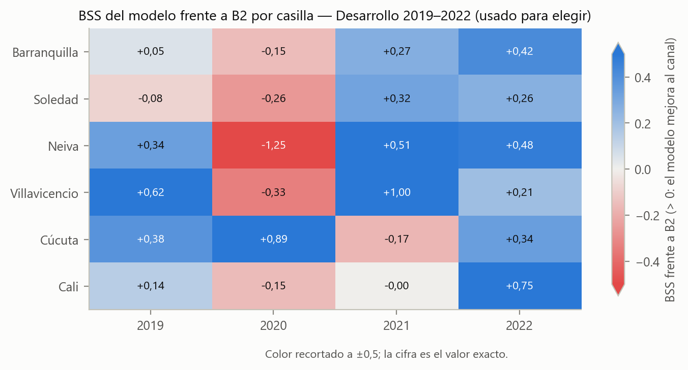

*Figura 17.* BSS frente a B2 por municipio y año, desarrollo (usado para elegir). Fuente: `figures/20261112/mapa_bss_desarrollo.png`.

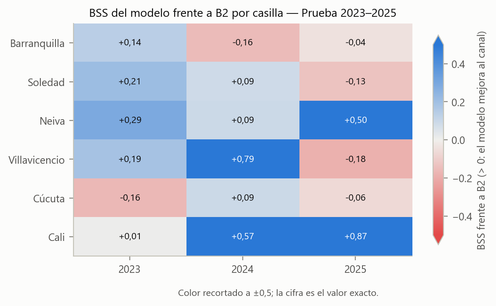

*Figura 18.* BSS frente a B2 por municipio y año, prueba. Fuente: `figures/20261112/mapa_bss_prueba.png`.

### 6.1 Desarrollo (usado para elegir)

**2019.** Año epidémico en cinco municipios; solo Barranquilla fue tranquila. El modelo gana a B2 en cinco casillas (pierde Soledad), con BSS +0,317, y B2 subestima más que el modelo (calibración −0,152 frente a −0,064). El año concentra 5 de los 10 inicios evaluables de desarrollo (el de Villavicencio del 2019-01-28 se censura). El modelo avisa cuatro y no avisa el de Villavicencio del 2019-11-25. Que la mitad de los inicios con que se eligió τ sean de un solo año es una limitación ya declarada (§7.8).

**2020.** Año post-epidémico en cuatro municipios (Soledad, Neiva, Villavicencio y Cúcuta) y epidémico en Barranquilla y Cali, con solo 24 semanas positivas. Es el peor año de desarrollo: BSS −0,241, una casilla ganada a B2 y, en etiqueta, el MCC más bajo, por debajo del de la persistencia. El modelo sobreestima más que B2 (+0,080 frente a +0,062) y pierde en las casillas post-epidémicas salvo Cúcuta. De este año salió H-R (sección 7). El único inicio evaluable (Barranquilla, 2020-01-27) lo avisan ambos, el modelo con 7 semanas más de anticipación.

**2021.** Epidémico en Barranquilla, Soledad y Cúcuta; tranquilo en Neiva y Villavicencio. El modelo gana cuatro casillas a B2 y las seis a B1. Pierde en Cúcuta, en un año epidémico (BSS −0,171), y en Cali, post-epidémica, por un margen mínimo (−0,001). Los dos inicios (Barranquilla y Cúcuta) los avisan ambos sistemas (Δw de 0 y +1).

**2022.** Epidémico en Barranquilla (51 de 52 semanas positivas), Soledad y Villavicencio. El modelo gana las seis casillas a B2 (BSS +0,324). No avisa el inicio de Soledad del 2022-02-28, que el canal sí avisa, y avisa el de Villavicencio del 2022-10-31 con 4 semanas más que el canal.

### 6.2 Prueba

**2023.** Epidémico en cinco municipios; Cúcuta fue tranquila, con una sola semana positiva. El modelo gana cinco casillas a B2 (BSS +0,149) y las seis a B1; la de Cúcuta la pierde por Brier y la gana por log-loss. Ambos sistemas subestiman en un año de prevalencia alta (45,5 %), el modelo menos. De los cuatro inicios, el canal avisa los cuatro y el modelo dos (los de Neiva). Los de Barranquilla y Soledad llegan con el modelo ya encendido desde noviembre de 2022.

**2024.** Epidémico en cinco municipios y post-epidémico en Villavicencio. Gana cinco casillas a B2 (BSS +0,153) y pierde Barranquilla (−0,156). La calibración en grande del modelo es casi exacta (−0,002) y su MCC en etiqueta supera al de la persistencia. Cada sistema avisa dos de tres inicios: ambos el de Cúcuta, solo el canal el de Neiva y solo el modelo el de Soledad.

**2025.** Es el año adverso: BSS −0,089, dos casillas ganadas a B2 y tres a B1. Fue post-epidémico en Barranquilla, Neiva y Cali, y epidémico en Soledad, Villavicencio y Cúcuta, con la prevalencia más baja de la prueba (18,3 %). Las dos casillas que gana son post-epidémicas y sin semanas positivas (Neiva y Cali); pierde las tres epidémicas y Barranquilla. La resolución del modelo cae a 0,025, frente a 0,131 en 2023 y 0,099 en 2024 (`reportes_20261112/murphy.csv`): ese año casi no distingue las semanas positivas. El modelo no avisa ninguno de los tres inicios; el canal avisa dos. Las series muestran además que, tras las epidemias de 2023 y 2024, U1e sube en 2025 en varios municipios (por ejemplo, Neiva en la Figura 2), porque los años epidémicos entran en la referencia de cinco años del canal. Ese desplazamiento acompaña la baja prevalencia de 2025, pero aquí no se le atribuye el resultado (apartado 8.6).

---

## 7. Contraste de las hipótesis H-R y H-E

Las hipótesis secundarias de §8.8 se formularon con los resultados de desarrollo y se contrastan solo en prueba, de forma descriptiva. Una parte es «no evaluable» si su estrato tiene menos de 2 casillas o de 2 inicios.

**Tabla 7.1.** Contraste en prueba. Fuentes: `prueba_20261112/diag_casillas.csv`, `diag_resumenes.csv`, `resumen_prueba.json` y `reportes_20261112/eventos_razon.csv` [H].

| Hipótesis | Resultado en prueba | Estado |
|---|---|---|
| H-R(a): en las casillas epidémicas, el modelo gana a B2 por log-loss en más de la mitad | 8 de 13 (por Brier, 9 de 13); en las filas juntas, mejora de log-loss +3,0 %, BSS +0,066 | **Sostenida** |
| H-R(b): en las post-epidémicas, el modelo pierde en más de la mitad | Pierde 1 de 4 (Barranquilla 2025); en las filas juntas, +34,5 % de log-loss y BSS +0,270 | **No sostenida** |
| H-R(c): en las post-epidémicas, el modelo sobreestima más que B2 | 0 de 4: su calibración en grande es menor que la de B2 en las cuatro (filas juntas: +0,043 frente a +0,110) | **No sostenida** |
| H-E(a): el modelo avisa menos inicios | 4 frente a 8 de 10 | **Sostenida** |
| H-E(b): el modelo tiene menos falsas alarmas por municipio-año | 1,00 frente a 1,67 | **Sostenida**, con la precisión de la sección 5: son menos porque hay menos alertas, no porque sean más precisas |
| H-E(c): en los inicios avisados por ambos, Δw > 0 en más de la mitad | 2 de 3 (Δw de 0, +7 y +5) | **Sostenida**, con 3 inicios. Los dos Δw positivos vienen de alertas largas: la de Neiva duró 66 semanas desde t_c y la de Cúcuta, 42 |

La única casilla tranquila de prueba (Cúcuta 2023) no forma estrato evaluable.

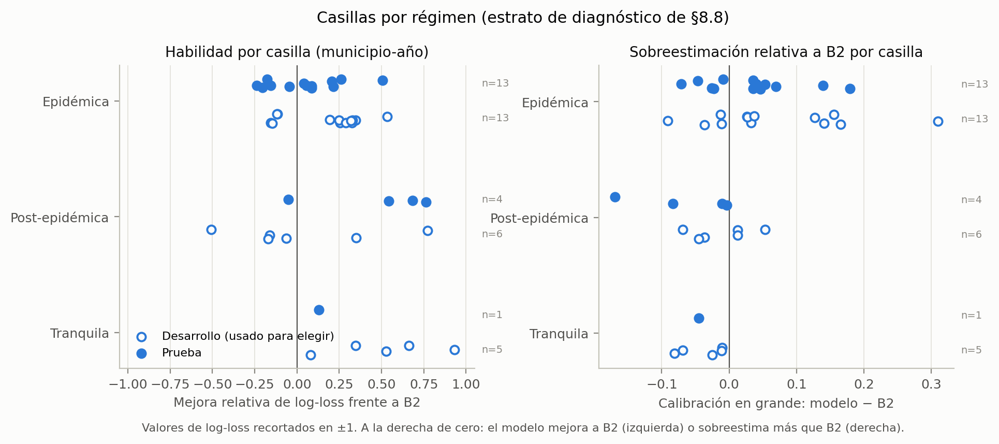

*Figura 19.* Mejora de log-loss frente a B2 (izquierda) y calibración en grande del modelo menos la de B2 (derecha), por casilla y régimen. Fuente: `figures/exploratorio_20261112/regimen_casillas.png`; datos, `prueba_20261112/diag_casillas.csv` y `diagnostico_desarrollo_sin_clima_20261112/diag_casillas.csv`.

**Lo que contradice a H-R.** En desarrollo, las casillas post-epidémicas favorecían a B2: el modelo ganaba 2 de 6 y sobreestimaba más que B2 en las tres de 2020 (Soledad, Neiva y Villavicencio), aunque no en las filas juntas (+0,101 frente a +0,113; `diagnostico_desarrollo_sin_clima_20261112/diag_resumenes.csv`). En prueba, las cuatro casillas post-epidémicas tienen 6 semanas positivas en 206 filas, B2 sobrestima más que el modelo en las cuatro y el modelo gana tres. El estrato anual no reproduce lo que H-R(b) y H-R(c) buscaban.

**Dónde aparece lo que H-R(b) buscaba** [X]. La pérdida del modelo después de una epidemia sí existe, pero a escala de semanas: entre 1 y 13 semanas después del fin de un episodio pierde frente a B2 en las 12 combinaciones municipio-período, y en esa ventana el p̂ medio (0,51) multiplica por ocho la frecuencia observada (0,065). El año calendario no capta esa ventana por dos motivos:

- Las semanas posteriores a un episodio que termina a mitad de año caen en un año clasificado como epidémico.
- Un año post-epidémico completo incluye muchas semanas tranquilas, en las que el modelo gana.

Es un hallazgo exploratorio, definido después de ver la prueba, y no reemplaza el contraste declarado.

---

## 8. Efecto de las métricas en la lectura

Esta sección recorre las limitaciones de las métricas que §8.8 pide discutir y añade las que surgieron en el análisis.

**8.1 Promedio de mejoras relativas frente a filas juntas.** §8.8 reporta dos agregados y pueden diferir mucho, incluso en signo (Tabla 8.1). En prueba, el BSS promedio de las casillas (+0,172) duplica el de las filas juntas (+0,081). La razón son las casillas con muy pocas positivas: allí el Brier de B2 es pequeño y la mejora relativa sale grande (Cali 2025, +0,868; Villavicencio 2024, +0,787; Neiva 2025, +0,504), y el promedio las pondera igual que una casilla epidémica. En desarrollo, la ablación frente a B2 cambia de signo: −0,084 como promedio de casillas y +0,070 con las filas juntas. La conclusión de §8.4 usa la métrica global sobre filas y el conteo de casillas, no el promedio de mejoras. El Brier y el log-loss también pueden discrepar en una casilla: Cúcuta 2023 y Cali 2023, en sentidos opuestos (sección 2).

**Tabla 8.1.** Dos agregados de la misma comparación. Fuente: `reportes_20261112/habilidad.csv` [H].

| Comparación | BSS, filas juntas | BSS, promedio de casillas | Log-loss, filas juntas | Log-loss, promedio de casillas |
|---|---|---|---|---|
| Modelo frente a B2, prueba | +0,081 | +0,172 | +6,3 % | +15,0 % |
| Modelo frente a B2, desarrollo | +0,188 | +0,190 | +18,4 % | +21,1 % |
| Modelo frente a B1, prueba | +0,468 | +0,399 | +43,5 % | +39,6 % |
| Con clima frente a B2, prueba | +0,067 | +0,102 | +4,4 % | +8,1 % |
| Con clima frente a B2, desarrollo | +0,070 | −0,084 | +5,3 % | −2,4 % |

**8.2 AP sin positivas y con empates.** La AP no está definida en las casillas sin semanas positivas: 2 en prueba (Neiva y Cali 2025) y 8 en desarrollo. Por eso se reporta global, por estrato y por municipio. Además, B2 toma pocos valores distintos (entre 6 y 9 por municipio en prueba) y su AP depende de cómo se traten los empates. El repositorio agrupa los empates en un mismo umbral (`src/forecasting/metrics.py`, `average_precision_score`). Un cálculo que los rompe por el orden de las filas da otra cifra, por ejemplo 0,77 en lugar de 0,60 para B2 en Barranquilla y 0,73 en lugar de 0,59 en Cúcuta, lo que invertiría la comparación con el modelo en esos dos municipios (`exploratorio_20261112/ap_empates.csv` [X]; el cálculo con empates agrupados reproduce exactamente la ficha). Las cifras válidas son las de la ficha. El modelo, con valores continuos, no tiene empates.

**8.3 Las métricas en un umbral dependen del umbral.** Sensibilidad, VPP, F1 y MCC describen un punto de operación, no la calidad de la probabilidad (§7.1). Con τ = 0,05 el modelo parece muy superior a B2 (MCC 0,46 frente a 0,26) y con τ = 0,30 iguala a la persistencia (apartado 3.3). Ninguna de las dos cifras es «la» calidad de la estimación; la juzgan las reglas de puntuación, la calibración y la discriminación sin umbral. Por la misma razón, el umbral que maximiza F1 se tomó de desarrollo y nunca de la prueba.

**8.4 B2 y la AUC dentro de una zona.** Dentro de una zona del canal, B2 solo varía entre municipios y años, así que su AUC en las zonas de alerta y epidemia (entre 0,36 y 0,48) mide si los municipios y años con más probabilidad asignada tuvieron más conversión, no si ordena semanas. Un valor por debajo de 0,5 no significa que B2 «ordene al revés» las semanas; refleja diferencias entre municipios. La comparación con el modelo por municipio (columna final de la Tabla 3.5) evita ese efecto.

**8.5 Detección en saltos de 10 puntos.** Con 10 inicios evaluables, cada inicio mueve la detección 10 puntos, y Cali no tiene inicios en prueba. Por eso se reportan también las entradas (41 en prueba) y la fase «antes» del análisis semanal (sección 5).

**8.6 La etiqueta se desplaza tras una epidemia.** U1e se calcula con los cinco años anteriores; tras una epidemia, los años epidémicos entran en esa referencia y el umbral sube (Figura 2, Neiva 2025). Las casillas post-epidémicas quedan con muy pocas positivas (6 en 206 filas en prueba), y eso afecta a la vez al promedio de mejoras (apartado 8.1), a la AP (apartado 8.2) y al contraste de H-R (sección 7).

**8.7 La descomposición de Murphy depende del agrupamiento.** Con 10 intervalos de igual frecuencia, la confiabilidad de B2 en prueba es 0,015 y su resolución, 0,087. Si se agrupa por sus valores exactos (44 grupos, residuo 0), son 0,033 y 0,105 (`exploratorio_20261112/murphy_b2.csv` [X]). La afirmación «misma resolución» solo vale con el mismo procedimiento de intervalos y no compara capacidades intrínsecas. La conclusión de que la ventaja global viene de la calibración (apartado 3.1) se apoya además en la calibración en grande por año, que no depende de intervalos, y la de que el modelo discrimina mejor, en la AP y la AUC (apartado 3.2).

**8.8 La restricción de τ no estuvo activa.** τ se elige maximizando la detección con falsas alarmas no mayores que las del canal (§7.5). En desarrollo, el modelo cumple la restricción en toda la rejilla (con τ = 0,05, 0,92 falsas alarmas por municipio-año frente a 2,00 del canal), así que τ lo decidió solo la detección y quedó en el extremo inferior de la rejilla (`seleccion_conjuntos_20261112/curva_tau.csv` y `resumen_seleccion.json`). Eso explica por qué el modelo pasa el 60 % de las semanas bajo alerta en prueba.

**8.9 Correlación entre casillas del mismo año.** Las 18 casillas de prueba no son 18 unidades independientes (§8.6): 2023 y 2024 fueron epidémicos en cinco municipios a la vez y en 2025 el modelo perdió en cuatro casillas al mismo tiempo. El conteo de 12 de 18 debe leerse con esa dependencia.

---

## 9. Desarrollo frente a prueba

**Tabla 9.1.** Desarrollo (usado para elegir) frente a prueba. Fuentes: `reportes_20261112/desarrollo_vs_prueba.csv` y `calibracion_anual.csv` [H]; AP, AUC y clasificación con τ = 0,30, `exploratorio_20261112/zona_canal.csv` y `clasificacion_umbrales.csv` [X].

| Cifra | Desarrollo | Prueba |
|---|---|---|
| Prevalencia | 25,6 % | 34,4 % |
| BSS del modelo frente a B2 (filas juntas) | +0,188 | +0,081 |
| Mejora de log-loss frente a B2 | +18,4 % | +6,3 % |
| Casillas ganadas a B2 (Brier) | 16 de 24 (67 %) | 12 de 18 (67 %) |
| BSS frente a B1 | +0,516 | +0,468 |
| Versión con clima: BSS frente a B2 | +0,070 | +0,067 |
| AP, modelo / B2 [X] | 0,76 / 0,62 | 0,77 / 0,61 |
| MCC con τ = 0,30, modelo / persistencia [X] | 0,65 / 0,65 | 0,58 / 0,59 |
| Detección, modelo / canal | 8 / 10 de 10 | 4 / 8 de 10 |
| Falsas alarmas por municipio-año, modelo / canal | 1,00 / 2,00 | 1,00 / 1,67 |

La proporción de casillas ganadas se mantiene (dos de cada tres), pero el tamaño de la mejora frente a B2 en las reglas de puntuación cae a menos de la mitad (BSS +0,188 → +0,081). Hay dos explicaciones compatibles [I]:

- **Sesgo de selección.** La familia, el conjunto de variables, la configuración común y τ se eligieron con estos mismos años. Los puntajes fuera de año protegen la elección de hiperparámetros, pero no las demás. Entre opciones con márgenes pequeños (la configuración elegida superó a la segunda por 0,0012 de mejora media; `seleccion_conjuntos_20261112/resumen_seleccion.json`), la ganadora tiende a parecer mejor de lo que es (regresión a la media).
- **Una prueba más epidémica:** prevalencia de 34,4 % frente a 25,6 %, e incluye un año adverso (2025).

Dos indicios ayudan a separar ambos efectos:

- **La versión con clima**, que no fue la elegida en el paso 0, casi no cambia entre períodos (+0,070 → +0,067), mientras que la elegida cae. Es coherente con que parte de la ventaja de desarrollo de la receta fuera optimismo de selección, aunque no lo prueba.
- **La discriminación se mantiene** (AP 0,76 → 0,77; AUC 0,92 → 0,87, con una AUC de la persistencia que también cae, de 0,82 a 0,80), mientras que la calibración relativa a B2 se estrecha. Lo que se reduce es el margen de calibración sobre B2, no la capacidad de ordenar las semanas.

En eventos la diferencia es mayor (8 de 10 → 4 de 10), como se espera de una cifra con la que se eligió τ. **La prueba es la estimación del tamaño real**: una mejora pequeña y en dirección favorable frente a B2 en las reglas de puntuación, con «tendencia favorable» como nivel de §8.4, y una discriminación claramente superior y estable.

---

## 10. Conclusiones

**Hechos [H].**
- Frente a B2, el modelo alcanza «tendencia favorable» (BSS +0,081; 12 de 18 casillas); frente a B1, «mejora consistente» (BSS +0,468; 15 de 18). El clima no aporta mejora medible y los eventos frente al canal quedan «sin mejora» (4 de 10 frente a 8 de 10).
- Por municipio (descriptivo): Neiva, Villavicencio y Cali son favorables en prueba; Soledad y Cúcuta, mixtos; Barranquilla, desfavorable. Neiva y Villavicencio también lo fueron en desarrollo.
- El modelo está mejor calibrado que B2 en prueba (confiabilidad 0,006 frente a 0,015 con 10 intervalos; calibración en grande más cerca de 0 los tres años) y ordena mejor las semanas (AP 0,77 frente a 0,61). Es demasiado extremo en ambas direcciones.
- Tiene menos falsas alarmas por municipio-año que el canal porque emite menos alertas, que duran más; la proporción de alertas falsas es similar (82 % frente a 77 %).
- H-R(a) y las tres partes de H-E se sostienen; H-R(b) y H-R(c) no.

**Inferencias [I].**
- El valor del modelo es **la calidad de la probabilidad**, no la etiqueta ni la alerta. Como probabilidad, está mejor calibrado, es más nítido y ordena mejor las semanas que B2, de forma estable entre períodos. Convertido en un sí o un no, iguala a la persistencia: lo que gana en transiciones lo pierde en semanas persistentes.
- Ese valor está en **graduar el estado actual del canal**: distinguir qué epidemias en curso continuarán, qué alertas del canal tienen más riesgo y qué períodos tranquilos lo seguirán siendo. No está en anticipar inicios, una sola semana por episodio en un objetivo que pesa por igual todas las semanas.
- La caída de la mejora entre desarrollo y prueba combina sesgo de selección y una prueba más epidémica; afecta al margen de calibración sobre B2, no a la discriminación.

**Exploratorio [X].**
- Dentro de cada zona del canal, el modelo separa semanas cuyo riesgo observado difiere entre dos y cinco veces, donde B2 asigna una sola probabilidad. Esto se repite en desarrollo y en prueba y en casi todos los municipios (Tabla 4.1).
- Con el umbral de F1 máxima de desarrollo, el modelo recupera el 23 % de las entradas y anticipa el 16 % de las salidas, con una precisión de dos a tres veces la tasa base; la persistencia no anticipa ninguna.
- La mejora neta frente a B2 se concentra durante los episodios (+109 %) y en las semanas tranquilas (+34 %), y se pierde en las 1–13 semanas posteriores a un episodio (−49 %), en casi todos los municipios y en ambos períodos.
- Que el modelo esté bajo alerta en 8 de 10 inicios no se distingue de su tasa base de semanas bajo alerta (unos 6 de 10).

**Valor en la práctica [I].** El sistema es un **estimador de riesgo a 8 semanas que complementa el canal**: lo enriquece donde el canal da una sola respuesta para situaciones muy distintas. Tiene tres usos principales: seguir una epidemia en curso (cuánto durará), priorizar las semanas en zona de alerta y confirmar la tranquilidad. No sustituye la alerta del canal para avisar inicios de brote. Su lectura exige dos advertencias: tras el fin de una epidemia, p̂ sobrestima la continuidad durante unas 13 semanas; y en zona de alerta, un p̂ bajo no significa riesgo nulo (2 % predicho, 7 % observado).

**Pendientes [P].**
- Incorporar `exploratorio_20261112/` y `figures/exploratorio_20261112/` a `reports/forecasting/INDICE.md`, con su estado (exploratorio).
- F8: registro de modelos, API y frontend. Las recomendaciones de presentación de la sección 4 son una propuesta para la vista principal y la ficha de desempeño.

---

## 11. Limitaciones y trabajo futuro

**Limitaciones.**
- **Tamaño de la prueba.** Tres años, 18 casillas correlacionadas y 10 inicios evaluables: la potencia es baja (§8.6) y los niveles por municipio son descriptivos.
- **Análisis exploratorios.** Los análisis [X] se definieron después de ver la prueba. Describen patrones, pero no confirman hipótesis. Sus cortes (8 semanas antes, 13 después, las bandas de la Tabla 4.1 y el umbral de 0,50) son convenciones de este análisis, no del contrato. Solo el umbral de F1 máxima (0,30) se tomó de desarrollo con una regla explícita.
- **Información posterior a la emisión.** El régimen y las fases la usan y nunca están disponibles al emitir. La zona del canal en t sí lo está.
- **Pronóstico retrospectivo,** con datos consolidados (§3.4).
- **Sin atribución causal.** Ningún resultado se atribuye a variables concretas ni a causas epidemiológicas (inmunidad, serotipos, notificación): este análisis no tiene evidencia para hacerlo.

**Trabajo futuro.** Son hipótesis para un ciclo nuevo, con su propio desarrollo y una prueba con datos no vistos (2026 en adelante), no cambios a la receta evaluada:
1. **Recalibración por zona del canal**, declarada y elegida en desarrollo, para corregir los extremos de p̂ en la zona de alerta sin perder el orden.
2. **Un modelo de P(entrada | fuera de zona epidémica en t)**, dirigido a la transición que el modelo actual anticipa poco, evaluado con entradas e inicios.
3. **Una regla de alerta que se apague**, por ejemplo con duración máxima o con reconfirmación, para que una alerta encendida más de 12 semanas no impida avisar el siguiente inicio. Debe elegirse en desarrollo con un criterio declarado antes.
4. **Una regla combinada con el canal**: la alerta del canal para los inicios y la probabilidad del modelo para la persistencia, la priorización de alertas y la vuelta a la tranquilidad, evaluada con la simetría de §7.4.
5. **Un tratamiento específico de la ventana posterior a un episodio**, declarado antes de evaluarlo, dado que es la debilidad más estable del modelo en ambos períodos.

---

## Fuentes

Evidencia congelada (`reports/forecasting/evidence/`):
- `prueba_20261112/`: `resumen_prueba.json`, `ficha_desempeno.json`, `diag_casillas.csv`, `diag_resumenes.csv`, `diag_transicion.csv`, `diag_eventos.csv`, `diag_serie.csv`.
- `diagnostico_desarrollo_sin_clima_20261112/`: los mismos insumos de §8.8 para desarrollo (usado para elegir).
- `reportes_20261112/` (U7.5): `habilidad.csv`, `casillas.csv`, `clasificacion_tau.csv`, `murphy.csv`, `confiabilidad.csv`, `calibracion_anual.csv`, `eventos_razon.csv`, `duracion_alertas.csv`, `curva_amoc.csv`, `desarrollo_vs_prueba.csv`, `manifiesto_reportes.json`.
- `seleccion_conjuntos_20261112/`: `resumen_seleccion.json`, `curva_tau.csv`.

Figuras de U7.5 (`reports/forecasting/figures/20261112/`): `resumen_municipios`, `serie_<código>`, `confiabilidad_<periodo>`, `amoc_<periodo>`, `mapa_bss_<periodo>`.

Exploratorio [X]:
- **Script:** `docs/forecasting/verificacion/analisis_integrado_exploratorio.py`. No importa nada de `src/` y reutiliza `caso_f7_diagnostico.py` sin modificarlo. Se ejecuta desde la raíz, con los datos de DVC:

  ```
  python -X utf8 -I docs/forecasting/verificacion/analisis_integrado_exploratorio.py --canal data/processed/epidemiology/pilot_weekly_channel.parquet --busqueda-sin-clima data/processed/forecasting/sin_clima --predicciones-prueba data/processed/forecasting/prueba/predicciones_prueba.parquet --evidencia reports/forecasting/evidence --salida-tablas reports/forecasting/evidence/exploratorio_20261112 --salida-figuras reports/forecasting/figures/exploratorio_20261112
  ```

- **Tablas** (`exploratorio_20261112/`):
  - Calidad de la estimación: `clasificacion_umbrales.csv`, `clasificacion_curva_tau.csv`, `zona_canal.csv`, `zona_canal_intervalos.csv`, `zona_canal_lectura.csv`, `murphy_b2.csv`, `ap_empates.csv`.
  - Estratos: `fases.csv`, `fases_municipio.csv`, `estratos_municipio.csv`, `semanas_desde_episodio.csv`, `episodios_entrenamiento.csv`, `rachas_positivas.csv`.
  - Eventos: `inicios_detalle.csv`, `tasa_base_alerta.csv`.
  - Control: `contraste_u75.csv` y `manifiesto_exploratorio.json` (md5 de los insumos y τ de F1 máxima en desarrollo).
- **Figuras** (`figures/exploratorio_20261112/`): `clasificacion_pr`, `clasificacion_umbral`, `zona_canal`, `fases_aporte`, `fases_municipio`, `semanas_desde_episodio`, `inicios_prueba`, `regimen_casillas`.

Documentos: `docs/forecasting/contrato_predictivo.md` (§2.2, §2.4, §7.1–§7.8, §8.2–§8.8, §9.2–§9.5) y `docs/forecasting/README.md` (glosario).
